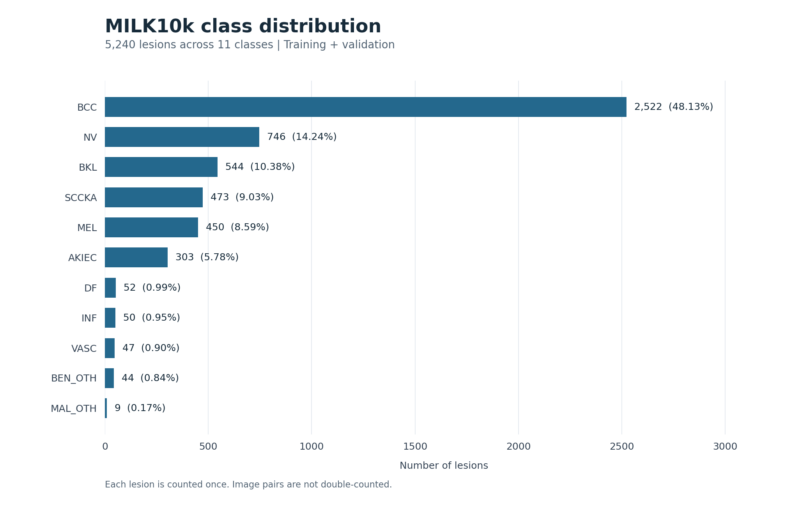
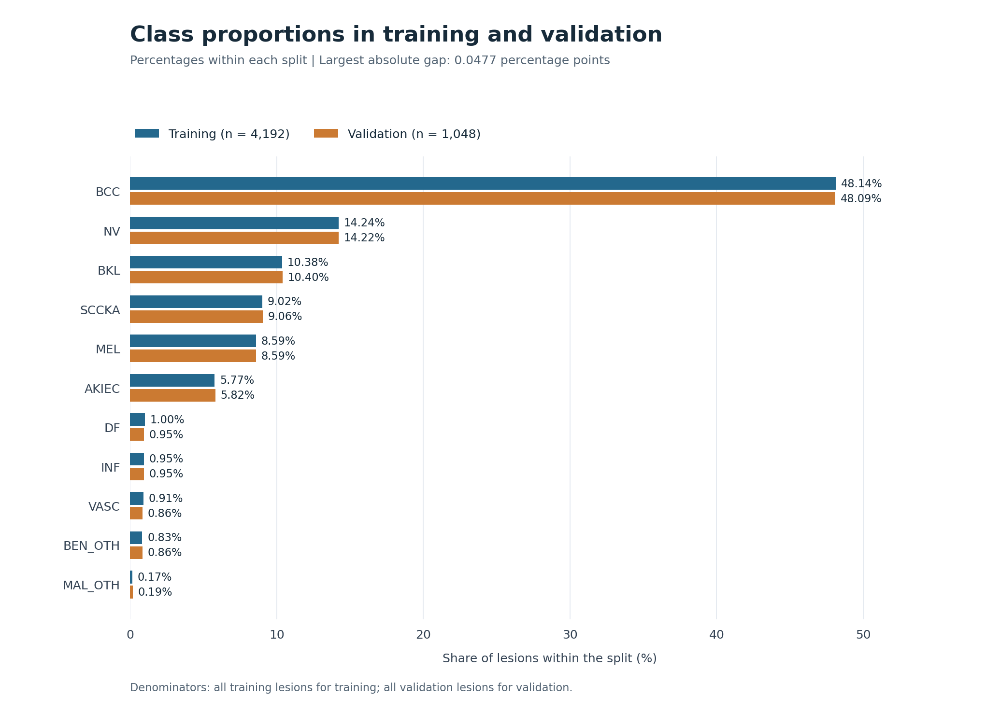

# MILK10k class distribution analysis

The supplied label files contain 5,240 lesions: 4,192 training (80%) and 1,048 validation (20%).
The largest-to-smallest present class count ratio is 280.2:1; the maximum split proportion difference is 0.0477 percentage points. Each row represents one lesion, not one image.

## Class counts and proportions

| Class | Training | Validation | Total | Total share | Training share | Validation share | Difference (pp) |
| --- | ---: | ---: | ---: | ---: | ---: | ---: | ---: |
| AKIEC | 242 | 61 | 303 | 5.78% | 5.77% | 5.82% | +0.0477 |
| BCC | 2,018 | 504 | 2,522 | 48.13% | 48.14% | 48.09% | -0.0477 |
| BEN_OTH | 35 | 9 | 44 | 0.84% | 0.83% | 0.86% | +0.0239 |
| BKL | 435 | 109 | 544 | 10.38% | 10.38% | 10.40% | +0.0239 |
| DF | 42 | 10 | 52 | 0.99% | 1.00% | 0.95% | -0.0477 |
| INF | 40 | 10 | 50 | 0.95% | 0.95% | 0.95% | +0.0000 |
| MAL_OTH | 7 | 2 | 9 | 0.17% | 0.17% | 0.19% | +0.0239 |
| MEL | 360 | 90 | 450 | 8.59% | 8.59% | 8.59% | +0.0000 |
| NV | 597 | 149 | 746 | 14.24% | 14.24% | 14.22% | -0.0239 |
| SCCKA | 378 | 95 | 473 | 9.03% | 9.02% | 9.06% | +0.0477 |
| VASC | 38 | 9 | 47 | 0.90% | 0.91% | 0.86% | -0.0477 |

Shares use the corresponding split size as denominator. Total share uses all lesions. Difference is validation share minus training share in percentage points. Displayed values are rounded; the CSV preserves more precision.

## Findings

- BCC is the largest class: 2,522 lesions (48.13% of all labels).
- MAL_OTH is the smallest present class: 9 lesions (0.17%). The largest class is 280.2 times as frequent.
- The largest absolute split proportion difference is 0.0477 percentage points (AKIEC). Similar proportions do not establish the splitting algorithm or random seed.
- MAL_OTH has only 2 validation lesions. Its per-class scores can be sensitive to individual predictions.

## Implications for evaluation

A classifier that always predicts the training majority class, BCC, would obtain 48.09% validation accuracy from label counts alone. This is a theoretical constant-prediction reference, not a trained-model result. Accuracy alone does not describe performance across all classes.

Use Macro F1 as the primary metric: it gives each of the 11 class F1 scores equal weight. Also report accuracy, per-class F1, support and a confusion matrix. Keep the same splits and class order across models. Macro F1 does not remove uncertainty from the very small validation classes.

## Method and reproducibility

Count the label column after checking for unique lesion IDs, disjoint splits, known class names and matching one-hot labels. Include zero-count classes. No resampling or label changes are made. This describes the supplied labels; it does not verify image availability, image quality or diagnostic correctness.

Sources are relative to the repository unless external inputs were specified:

- training: DATA/PROCESSED_DATA/train_split.csv (SHA-256: ffca74529e57449cb11e506cfa2fce959bf7d559ff1f97834a0f14b6d2875234).
- validation: DATA/PROCESSED_DATA/val_split.csv (SHA-256: c40b840c94668d8494d06139dca6bd0fa5b6302f45056f6309abfab4b7b76022).

Run from the repository root: python src/analyze_class_distribution.py

The script writes class_distribution.csv, summary.json, this report and two PNG figures. Existing outputs with these names are replaced on rerun. Default paths are anchored to the script location, so running from another directory also works. Optional arguments: --train-csv, --val-csv and --output-dir.

Runtime versions: Python 3.13.0, Matplotlib 3.10.8.
