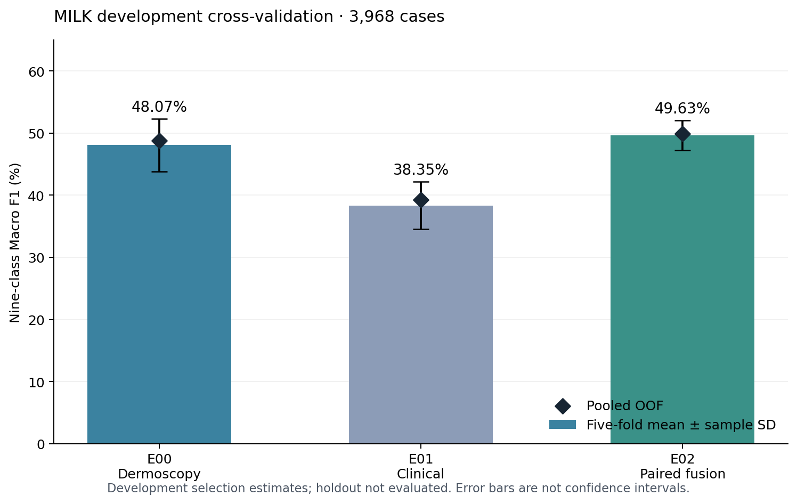

# 2026-10-29 核心 ResNet 五折结果

E00、E01、E02 各五折均已完成。三个实验使用相同的 3,968 例 MILK 开发病例、冻结分折和 ImageNet V2 初始化；每折独立训练。固定 holdout 未评估，ISIC 未进入核心训练。

| 实验 | 输入 | 五折 Macro F1 均值 ± 样本标准差 | pooled OOF Macro F1 | 预定 refit epoch |
|---|---|---:|---:|---:|
| E00 | 皮肤镜 | 48.07% ± 4.23 个百分点 | 48.81% | 39 |
| E01 | 临床照片 | 38.35% ± 3.81 个百分点 | 39.23% | 32 |
| E02 | 皮肤镜＋临床简单融合 | 49.63% ± 2.39 个百分点 | 49.93% | 20 |

完整精度见 [summary_metrics.csv](summary_metrics.csv)，各折轮数和指标见 [fold_metrics.csv](fold_metrics.csv)，设置及来源哈希见 [public_summary.json](public_summary.json)。

E02 五折均值比 E00 高约 1.56 个百分点，E01 较低。这是本协议下的描述性比较，尚未做显著性检验。验证折参与选择最佳 epoch，因此这些是开发选模估计，不是最终 holdout 成绩。

每折最多 100 epoch，按验证 Macro F1 严格改善保存最佳，同分保留较早 epoch，patience 15。E00 fold 0 达到 100 轮，其余 14 折早停；三组 OOF 均覆盖每个开发病例恰好一次。

H100 MIG 1g.10gb、batch 32、4 workers、最多两折并发。从第一折启动到汇总完成共 **51 分 44 秒**，含调度间隔和汇总；15 个任务累计分片占用 **1 小时 29 分 35 秒**。这是本次实测，不能保证后续耗时相同。

最终验收核对 30 个 checkpoint，并用 15 个最佳模型重推理验证折；最大概率绝对差为 0，保持原 `rtol=1e-4, atol=1e-5` 检查。训练基于 `c8796f8` 加 cuDNN 调整，实际来源以 JSON 中源码指纹为准；后来的交付提交号不替代训练指纹。

E03～E09、refit 和 holdout 仍未执行。上表 refit epoch 是预先规定的五折最佳 epoch 中位数，不表示已运行。没有患者 ID，不能宣称患者级隔离；固定 holdout 不是项目历史上从未使用过的外部盲测。
