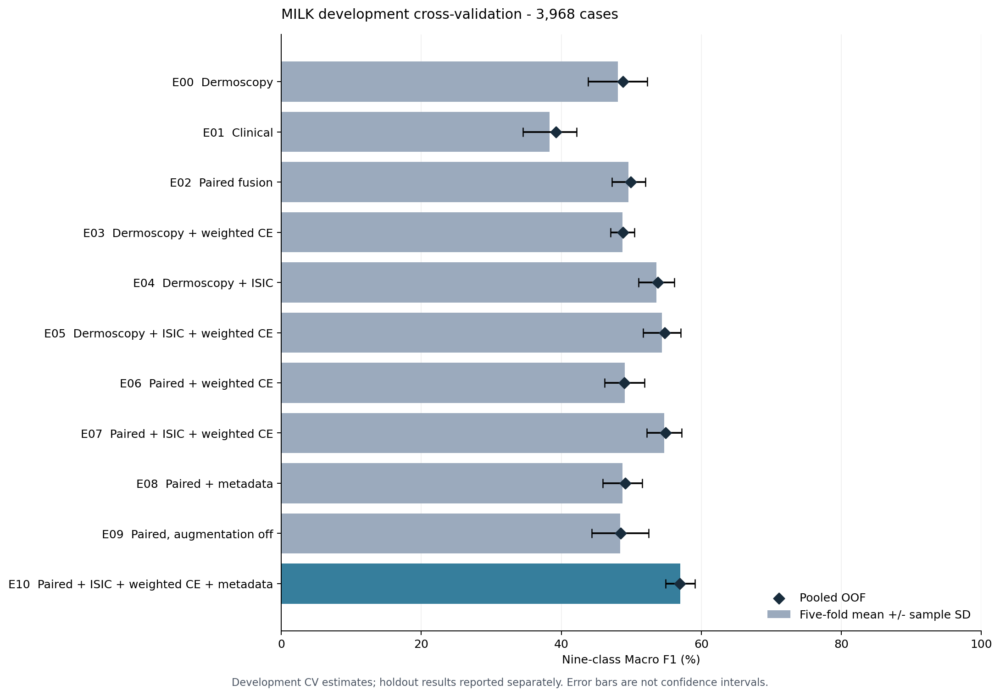

# E00–E10 development cross-validation

All eleven configurations completed five folds by 2026-10-31. Each experiment's
pooled OOF set covers the same 3,968 MILK development cases exactly once.
The 110 CV checkpoints were audited; 55 best checkpoints reproduced their full
validation-fold probabilities with maximum absolute difference 0.

| Experiment | Configuration | Five-fold Macro F1 mean +/- sample SD | Pooled OOF Macro F1 |
| --- | --- | ---: | ---: |
| E00 | Dermoscopy | 48.07% +/- 4.23 pp | 48.81% |
| E01 | Clinical | 38.35% +/- 3.81 pp | 39.23% |
| E02 | Paired fusion | 49.63% +/- 2.39 pp | 49.93% |
| E03 | Dermoscopy + weighted CE | 48.75% +/- 1.72 pp | 48.81% |
| E04 | Dermoscopy + ISIC | 53.59% +/- 2.58 pp | 53.77% |
| E05 | Dermoscopy + ISIC + weighted CE | 54.39% +/- 2.69 pp | 54.76% |
| E06 | Paired + weighted CE | 49.06% +/- 2.84 pp | 48.99% |
| E07 | Paired + ISIC + weighted CE | 54.70% +/- 2.51 pp | 54.89% |
| E08 | Paired + metadata | 48.73% +/- 2.81 pp | 49.12% |
| E09 | Paired, augmentation off | 48.40% +/- 4.05 pp | 48.49% |
| E10 | Paired + ISIC + weighted CE + metadata | 57.00% +/- 2.07 pp | 56.92% |

Exact numbers are in [summary_metrics.csv](summary_metrics.csv),
[fold_metrics.csv](fold_metrics.csv) and [public_summary.json](public_summary.json).
The JSON is a public aggregate export updated with completed refit/holdout status;
it is not an unmodified historical run record.

E10 adds metadata to E07's paired ResNet + ISIC + inverse-frequency weighted CE.
Their only configuration change is metadata. Comparing E10 against E08 also
changes ISIC expansion and weighting. E10 was added after inspecting E00–E09;
the group selected it as primary by highest five-fold mean nine-class Macro F1,
with E07 as control. E10's mean F1 is 2.30 percentage points higher, while its
mean Accuracy is 71.22% versus E07's 71.57%. See the
[fold comparison](e10_vs_e07_folds.csv) and
[pooled class comparison](e10_vs_e07_per_class.csv).

The selected models were independently refitted for 13 (E10) and 14 (E07) epochs,
the medians of their best CV epochs. Both completed, then evaluated the same
fixed holdout. See the [final holdout results](../../holdout/20261031_holdout_e10_e07_v1/SUMMARY.md).
Other configurations' prescribed epoch counts in the table do not mean they
were refitted. Roles were fixed before holdout evaluation.

Validation selected the epoch in each fold, so CV is a development estimate.
Sample SD is not a confidence interval, and score differences are not significance
tests. The holdout has historical exposure; patient-level isolation cannot be
claimed because official tables have no patient IDs.

Pooled OOF class tables and confusion matrices are retained for
[E00–E02](../20261029_core/SUMMARY.md), E03–E09 under
`../20261030_expansion/E03/summary/pooled_oof/` through `E09`, and
[E10](E10/summary/pooled_oof/per_class_metrics.csv). No case-level predictions,
labels or raw run records are published. Training source fingerprints are
preserved per experiment in the public JSON; this later public branch is not
the original training snapshot.

The integrated public version includes E10's configuration and experiment
registration, data acceptance and the [refit summary](../../refit/20261031_e10_e07_v1/README.md).
See the [delivery record](../../../docs/contributions.md) for integration checks.
