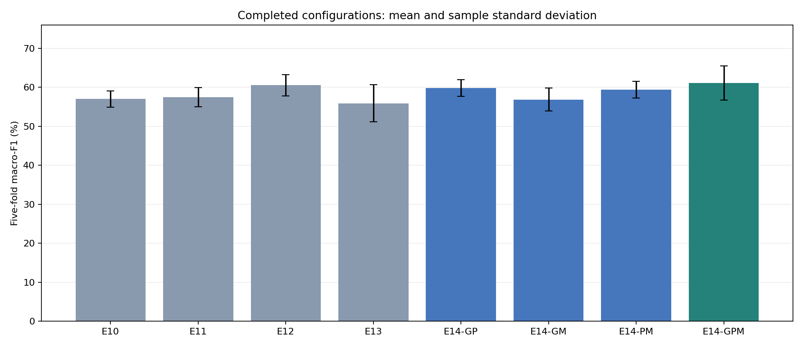

# E11–E14 aggregate cross-validation results

Published with C's 2026-11-16 contribution; the directory retains the preparation date 2026-11-15. E11–E13 and the four E14 configurations each completed five folds: 35 new folds. E10 is the previously completed reference. Every pooled OOF result covers the same 3,968 development cases; 20,279 ISIC images are training-side only. The fixed 1,037-case holdout is excluded from these CV scores.

| Configuration | Mean macro F1 (%) | Sample SD (percentage points) | Pooled OOF macro F1 (%) | Median best epoch |
|---|---:|---:|---:|---:|
| E10 | 57.0018 | 2.0702 | 56.9162 | 13 |
| E11 | 57.4458 | 2.4523 | 57.2813 | 33 |
| E12 | 60.5255 | 2.7319 | 60.4018 | 32 |
| E13 | 55.9063 | 4.7298 | 55.5799 | 22 |
| E14-GP | 59.8351 | 2.1435 | 59.6693 | 19 |
| E14-GM | 56.8521 | 2.9734 | 56.9586 | 23 |
| E14-PM | 59.3667 | 2.1196 | 59.2620 | 16 |
| E14-GPM | 61.0934 | 4.3545 | 60.8607 | 46 |

Full precision is preserved in [summary_metrics.csv](summary_metrics.csv) and the 40 aggregate fold records in [fold_metrics.csv](fold_metrics.csv). Pooled OOF F1 is computed from saved OOF predictions; it is not the average of the fold F1 scores. No case identifiers, labels or per-case probabilities are included here.

The selected configuration is E14-GPM under the previously recorded primary rule: highest unrounded mean five-fold nine-class macro F1. It exceeds E12 by 0.5678826 percentage points and wins only 2 of the 5 paired folds. The error bars are sample standard deviations, not confidence intervals; folds share a development pool and each selects its best epoch. Combination search adds selection bias, so the numerical lead is not evidence of a stable or statistically significant advantage.

GPM's best epochs are 23, 19, 46, 55, 47; the fixed refit length is their median, 46. The approved refit uses 3,968 development plus 20,279 ISIC examples, independent official pretrained initialization, and freshly fitted training-side metadata/class weights. The last saved observation on 2026-11-15 was queued, with actual training start unconfirmed; no refit completion or new holdout result is claimed. The previously used holdout is not a new blind test.

## Evidence and reproducibility boundary

The new 35-fold acceptance used the user's approved reduced scope: completion histories, saved-prediction metric recomputation, OOF membership checks, and byte-level checksums of recovered artifacts. It did not reload every formal checkpoint or rerun all formal validation predictions. Earlier synthetic/GPU smoke checks remain separate evidence. E10's earlier acceptance remains as documented in its original public report.

These are results of the frozen training snapshots below. The public C branch and a future A/B/C integration have different full source fingerprints; this publication does not claim that the current C-only public tree produced those GPU runs. Refit must retain its selected CV source/configuration/asset checks. Checksums identify the underlying records, but raw run records and case-level inputs are not distributed here, so this aggregate-only release is insufficient by itself to repeat training or independently recompute OOF predictions.

| Configuration | Frozen training-source SHA256 | Original aggregate-summary SHA256 |
|---|---|---|
| E10 | `a8a74758b6f29c9c78ab838c7b3f8d7d565fdaf4674f9f90830463a8888d1e9d` | `2da23e074db869272b7acd4a5db514c98bc57a02f9fa5c34ec4ac74a63a6ef0b` |
| E11 | `35a339ad55fc448c95474206aa7aa0f09f067125b91304740ed37d451507477b` | `8ea2e694f9f5c2705bf3080d5e0af548060e8cee0637d05e64ed8ceab8bd834b` |
| E12 | `35a339ad55fc448c95474206aa7aa0f09f067125b91304740ed37d451507477b` | `7a6d8b30946901fff0fa22726089c79249e1420d1159ce7236cefb346419adf1` |
| E13 | `35a339ad55fc448c95474206aa7aa0f09f067125b91304740ed37d451507477b` | `d2fd9a690b9a0de898ac472dd50f06df43aae0a5a18248d2a3b6dc759dafd8a2` |
| E14-GP | `2919f6c08346326105591ca22a5404d80d76bfe3f158d48b5bf73fe8cebbed0b` | `db61970dcedbe07933f96c415a631bdc4486c99e3bd391eac296296e5f95e58d` |
| E14-GM | `2919f6c08346326105591ca22a5404d80d76bfe3f158d48b5bf73fe8cebbed0b` | `cf7a6f40858c729537f7fba28d48a6f622250cbf464d9c0af1e84306ec38c4da` |
| E14-PM | `2919f6c08346326105591ca22a5404d80d76bfe3f158d48b5bf73fe8cebbed0b` | `f0efd76726634432b1ac818bd1d24869bb0930be8b4de02e4152b641360dfb8a` |
| E14-GPM | `2631da2e9babb81ee448889b71723526e50f56d74b8242b8665b47bde49521dd` | `869ce3dd6027fcdeda74658c9a195b9ff3f82a0728972d2a1eb92b3f49f31b09` |

Foundation-model pretraining overlap with evaluation populations has not been fully established. The data lack patient IDs, so the existing lesion/similarity-group safeguards must not be described as verified patient-level isolation. Upstream model licenses and attribution continue to apply. See the [model-selection record](../../../docs/model_selection.md), [pair implementation contract](../../../docs/e14_pairs_implementation.md) and [three-component contract](../../../docs/e14_gpm_implementation.md).
